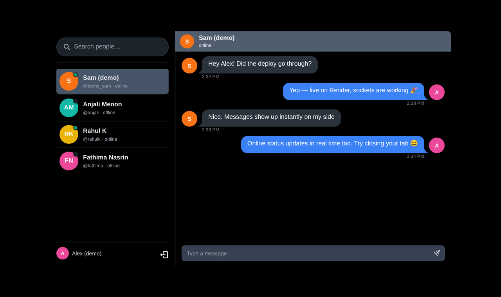
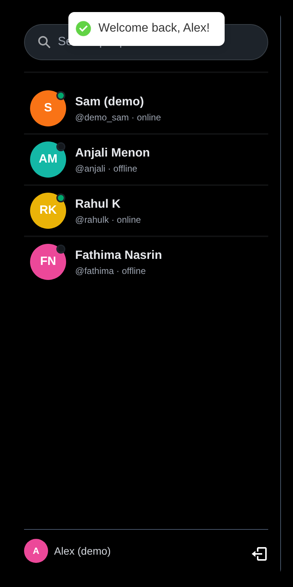
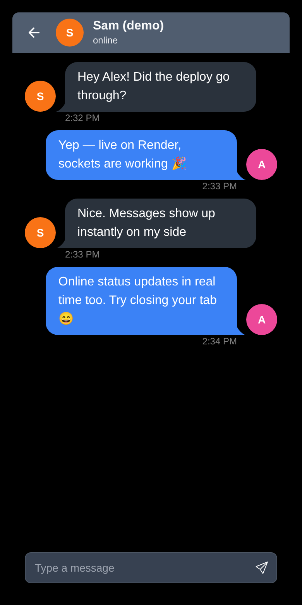
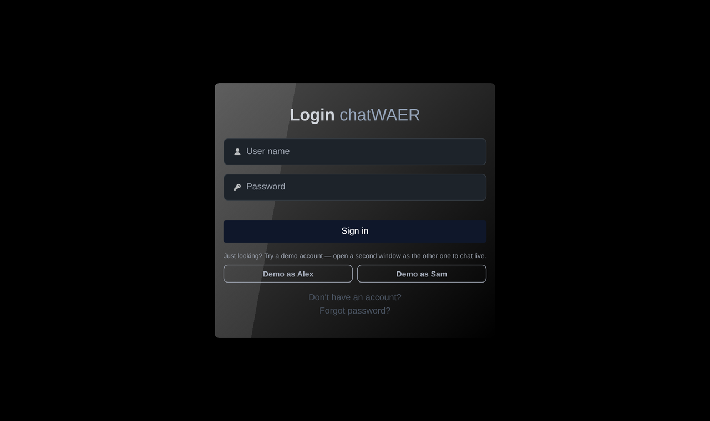

<div align="center">

# chatWAER

**Real-time one-to-one chat built with the MERN stack and Socket.IO**

[](https://github.com/salmanck66/ChatAPP_MERN/actions/workflows/ci.yml)


**[▶ Live demo — chatwaer.onrender.com](https://chatwaer.onrender.com/)**  
<sub>Click <b>Demo as Alex</b>, then open a private window and click <b>Demo as Sam</b> to chat between them in real time.<br>Hosted on Render's free tier, so the first load after a quiet spell can take ~50 seconds to wake up.</sub>



</div>

## Features

- **Real-time messaging.** Messages arrive instantly over WebSockets, with a notification sound and a toast when they come from a chat you don't have open.
- **Live presence.** Online/offline status updates as people connect and disconnect, and it handles several tabs per user.
- **Secure auth.** JWT in an `httpOnly`, `SameSite=strict` cookie, bcrypt password hashing, and rate-limited auth endpoints.
- **Password reset by email.** Single-use tokens that expire after one hour. Only a hash of each token is stored.
- **Responsive.** Two-pane layout on desktop, one pane at a time with a back button on mobile.
- **Live search** through contacts by name or username.
- **One-click demo accounts**, so anyone can try it without signing up.

<p align="center">
  
  &nbsp;&nbsp;
  
  &nbsp;&nbsp;
  
</p>

## Tech stack

| Layer | Tools |
|---|---|
| Frontend | React 18, Vite, React Router, Zustand, Tailwind CSS + daisyUI, socket.io-client |
| Backend | Node.js, Express, Socket.IO, Mongoose |
| Database | MongoDB Atlas |
| Auth & security | JWT (httpOnly cookie), bcrypt, express-rate-limit, Nodemailer |
| Hosting / CI | Render (single service serves the API, WebSocket and SPA), GitHub Actions |

## How it works

```
React (Vite build) ──HTTP /api──▶ Express ──▶ MongoDB
        ▲                            │
        └──── WebSocket (Socket.IO) ◀┘  same origin, same JWT cookie
```

- One Express server serves the REST API, the Socket.IO endpoint and the built React app from a **single origin**. That avoids CORS entirely and lets the WebSocket reuse the login cookie.
- **The socket handshake is authenticated** by verifying the same `httpOnly` JWT cookie the REST API uses. The client never sends its own user ID, so it can't impersonate anyone else.
- Each socket joins a room named after its user ID. Sending a message saves it to MongoDB and then emits it to the recipient's room, which reaches every tab they have open.

## Things I fixed and hardened

This started as a learning project. I came back to it and treated it like production code:

- **Closed an account-takeover hole.** The contacts endpoint returned full user documents, including password-reset tokens. It now returns only public fields, and reset tokens are stored hashed.
- **Moved socket identity to the server.** It came from a client-supplied `userId` query param; now it comes from the verified JWT.
- **Fixed cross-chat leakage.** Incoming messages were appended to whichever chat was open, even when they came from a different person.
- **Fixed the cookie `secure` flag**, which was inverted (set in development, missing in production).
- **Finished the password-reset flow.** The confirm route and page were missing. The endpoint no longer reveals whether an account exists.
- **Removed hard-coded URLs and ports** in favour of environment config, and added a health check plus a Render Blueprint for one-click deploys.

## Run locally

**Requirements:** Node 18+ and a MongoDB connection string (a free [Atlas](https://www.mongodb.com/atlas) cluster works).

```bash
git clone https://github.com/salmanck66/ChatAPP_MERN.git
cd ChatAPP_MERN
cp .env.example .env          # add MONGO_CONNECTION and JWT_SECRET
npm install && npm install --prefix frontend

npm run dev                   # API + sockets on http://localhost:3000
npm run dev:client            # React app on http://localhost:3001 (proxies /api and /socket.io)
```

Production build: `npm run build && npm start`, then open http://localhost:3000.

### Environment variables

| Variable | Required | Purpose |
|---|---|---|
| `MONGO_CONNECTION` | ✅ | MongoDB connection string |
| `JWT_SECRET` | ✅ | Secret for signing session tokens |
| `DEMO_MODE` | | `true` creates the `demo_alex` / `demo_sam` accounts on startup |
| `EMAIL`, `EMAIL_PASSWORD` | | Gmail address + [App Password](https://myaccount.google.com/apppasswords) for reset emails |
| `APP_URL` | | Public URL used in reset links (defaults to the request host) |
| `PORT` | | Defaults to `3000` |

## Deploy your own

[](https://render.com/deploy?repo=https://github.com/salmanck66/ChatAPP_MERN)

The included [`render.yaml`](render.yaml) creates the web service, generates `JWT_SECRET` and asks you for `MONGO_CONNECTION`. In Atlas, allow network access from `0.0.0.0/0` (Render's free tier has no fixed outbound IP).

## API

| Method | Route | Auth | Description |
|---|---|---|---|
| `POST` | `/api/auth/signup` | — | Create an account |
| `POST` | `/api/auth/login` | — | Log in, sets the session cookie |
| `POST` | `/api/auth/logout` | — | Clear the session |
| `POST` | `/api/auth/resetpasswordrequest` | — | Email a reset link |
| `POST` | `/api/auth/reset-password/:token` | — | Set a new password |
| `GET` | `/api/users` | ✅ | Contacts list (public fields only) |
| `GET` | `/api/messages/recieve/:userId` | ✅ | Conversation history |
| `POST` | `/api/messages/send/:userId` | ✅ | Send a message |
| `GET` | `/api/health` | — | Health check |

## Roadmap

- Unread counts and last-message previews in the sidebar
- Typing indicators and read receipts
- Paginated message history
- Image attachments

---

Built by **[Salmanul Faris C K](https://github.com/salmanck66)** · [LinkedIn](https://www.linkedin.com/in/salmanul-faris-c-k/)
